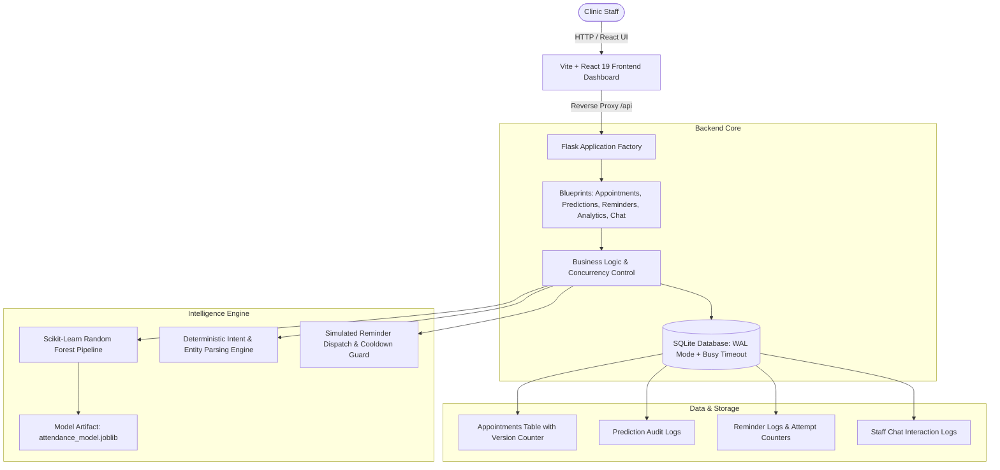

# MediTrack AI — Clinical Appointment Assistant & Attendance Intelligence

[](backend/tests)
[](frontend)
[](backend)
[](LICENSE)

MediTrack AI is an intelligent healthcare appointment management dashboard designed to reduce clinic no-show rates. It pairs an electronic scheduling database with real-time **machine learning attendance probability scoring**, **automated simulated patient reminder dispatch with duplicate protection**, and an **on-premise deterministic NLP staff chatbot assistant**.

---

## Architecture Diagram



---

## Features

- **Clinical KPI Dashboard**: Live tracking of total appointments, expected attendance rates, high-risk flags, and reminders dispatched.
- **Appointment Schedule Management**: Paginated table with real-time search (by patient name, reference `PAT-`, or appointment code `APT-`), department filters, status filters, and risk thresholds.
- **Optimistic Concurrency Control**: Prevents stale edits, race conditions, and accidental overwrites using version tracking (`version` counter) and SQLite WAL mode.
- **Machine Learning No-Show Prediction**: Every appointment receives an attendance likelihood score (Low: <30%, Medium: 30-60%, High: &ge;60% no-show risk) derived from lead time, historical attendance, appointment hour, day of the week, and department baselines.
- **Simulated Patient Reminder Dispatch**: AI-recommended follow-ups with one-click dispatch, duplicate dispatch prevention, and 24-hour cooldown enforcement.
- **Deterministic Staff Assistant Chatbot**: Natural language query resolution (`POST /api/chat`) supporting appointment lookups, risk inquiries, schedule modifications, and statistics summaries without external LLM dependencies or API fees.
- **Interactive Visualizations**: Recharts data displays for 7-day appointment flow, risk category proportions, and department workloads.

---

## Project Structure

```
meditrack-ai/
├── backend/
│   ├── app/
│   │   ├── __init__.py           # Flask application factory & error handlers
│   │   ├── config.py             # Config & SQLite concurrency options
│   │   ├── extensions.py         # SQLAlchemy & CORS instances
│   │   ├── ml/                   # ML training, data generator & inference
│   │   │   ├── artifacts/        # Serialized model & metrics.json
│   │   │   ├── generate_data.py  # Synthetic data generation script
│   │   │   ├── predict.py        # Real-time scoring pipeline
│   │   │   └── train_model.py    # Model trainer & baseline evaluator
│   │   ├── models/               # SQLAlchemy models (Appointment, PredictionLog, etc.)
│   │   ├── routes/               # Flask blueprints (appointments, chat, health, etc.)
│   │   ├── services/             # Core business rules & optimistic concurrency
│   │   └── utils/                # Input sanitization, validators & exceptions
│   ├── meditrack.db              # Seeded SQLite database with WAL mode
│   ├── requirements.txt          # Python dependencies
│   ├── run.py                    # Server entrypoint (Flask Dev & Waitress WSGI)
│   ├── scripts/
│   │   └── seed_database.py      # Database seeding script (60 appointments)
│   └── tests/                    # Automated pytest suite (32 unit & concurrency tests)
├── data/
│   ├── README.md                 # Synthetic data notice
│   └── synthetic_appointments.csv# 1,200 synthetic training samples
├── frontend/
│   ├── package.json              # React 19, Recharts, Lucide-React, Axios
│   ├── vite.config.js            # Vite proxy forwarding /api -> http://127.0.0.1:5000
│   ├── index.html                # Entry HTML with meta description & title
│   └── src/
│       ├── api/client.js         # Centralized Axios API client with error handling
│       ├── components/           # Reusable UI components
│       │   ├── AnalyticsCharts.jsx   # Recharts charts
│       │   ├── AppointmentModals.jsx # Create, Reschedule, Cancel & ML Modals
│       │   ├── AppointmentTable.jsx  # Filterable appointments data table
│       │   ├── ChatbotDrawer.jsx     # Floating staff assistant chat widget
│       │   ├── KpiCards.jsx          # Metric cards
│       │   ├── Navbar.jsx            # Header & system readiness indicator
│       │   ├── ReminderCenter.jsx    # AI reminder recommendations
│       │   └── Toast.jsx             # Notification toasts
│       ├── App.jsx               # Main React dashboard application
│       ├── index.css             # Healthcare design system & responsive styling
│       └── main.jsx              # React DOM root
└── README.md                     # Project documentation
```

---

## Installation & Setup (Windows PowerShell)

### Prerequisites
- **Python 3.10+**
- **Node.js 18+** & **npm**
- **Git**

### 1. Clone & Setup Backend Virtual Environment

Open Windows PowerShell:

```powershell
# Navigate into the project directory
cd c:\Users\hp\OneDrive\Desktop\meditrack-ai

# Navigate to backend
cd backend

# Create Python virtual environment
python -m venv .venv

# Activate virtual environment
.\.venv\Scripts\Activate.ps1

# Upgrade pip and install backend dependencies
pip install --upgrade pip
pip install -r requirements.txt
```

### 2. Initialize Database & Train ML Model (If not already initialized)

```powershell
# (Still in backend directory with virtual environment activated)

# 1. Generate synthetic appointment training data
python app/ml/generate_data.py

# 2. Train and evaluate the attendance prediction model
python app/ml/train_model.py

# 3. Seed SQLite database with realistic clinic appointments
python scripts/seed_database.py
```

### 3. Setup Frontend Dependencies

Open a second PowerShell window or navigate to `frontend`:

```powershell
cd c:\Users\hp\OneDrive\Desktop\meditrack-ai\frontend

# Install node dependencies
npm install
```

---

## Running the Application

### Start the Backend Server (Port 5000)

In PowerShell Terminal 1:

```powershell
cd c:\Users\hp\OneDrive\Desktop\meditrack-ai\backend
.\.venv\Scripts\Activate.ps1

# Start Flask Development Server:
python run.py

# Or start with Waitress Production WSGI Server:
python run.py --prod
```
Backend API will be running at `http://127.0.0.1:5000`.

### Start the Frontend Dev Server (Port 5173)

In PowerShell Terminal 2:

```powershell
cd c:\Users\hp\OneDrive\Desktop\meditrack-ai\frontend

npm run dev
```
Open your browser and navigate to `http://localhost:5173`. Vite will proxy `/api` calls directly to the Flask backend.

---

## API Reference

| Method | Endpoint | Description |
|---|---|---|
| `GET` | `/api/health` | System health check (DB connectivity & ML model status) |
| `GET` | `/api/appointments` | List appointments (supports `page`, `per_page`, `search`, `department`, `status`, `risk_category`) |
| `GET` | `/api/appointments/<id_or_code>` | Retrieve detailed appointment with prediction & reminders |
| `POST` | `/api/appointments` | Create new appointment (`patient_name`, `department`, `appointment_datetime`, `notes`) |
| `POST` | `/api/appointments/<id_or_code>/reschedule` | Reschedule appointment with concurrency check (`appointment_datetime`, `version`) |
| `POST` | `/api/appointments/<id_or_code>/cancel` | Cancel appointment (`reason`, `version`) |
| `PATCH` | `/api/appointments/<id_or_code>` | Update operational notes or status |
| `GET` | `/api/predictions/<appointment_id>` | Get latest ML prediction for an appointment |
| `POST` | `/api/predictions/<appointment_id>/refresh` | Force re-calculation of prediction with latest lead-time |
| `GET` | `/api/reminders/recommendations` | Get appointments requiring reminders based on risk thresholds |
| `POST` | `/api/reminders/<appointment_id>/send` | Dispatch simulated SMS reminder with duplicate prevention |
| `GET` | `/api/analytics/summary` | Real-time clinic KPIs (counts, no-show rate, high-risk count) |
| `GET` | `/api/analytics/trends` | Recharts chart data (7-day timeline, risk breakdown, department volumes) |
| `POST` | `/api/chat` | Deterministic clinic staff chatbot query resolution |

---

## Automated Testing & Validation

### Run Backend Test Suite

The test suite validates appointment workflows, input validations, deterministic chatbot parsing, machine learning inference, and multi-threaded optimistic concurrency:

```powershell
cd c:\Users\hp\OneDrive\Desktop\meditrack-ai
.\backend\.venv\Scripts\python.exe -m pytest backend/tests -v
```

Expected output:
```
backend/tests/test_appointments.py ...........                           [ 34%]
backend/tests/test_chatbot.py ...........                                [ 68%]
backend/tests/test_concurrency.py ...                                    [ 78%]
backend/tests/test_predictions.py ....                                   [ 90%]
backend/tests/test_reminders.py ...                                      [100%]
======================= 32 passed, 1 warning in 6.37s ========================
```

### Run Frontend Production Build & Linting

```powershell
cd c:\Users\hp\OneDrive\Desktop\meditrack-ai\frontend

# Verify production bundle compilation
npm run build

# Run Oxlint
npm run lint
```

---

## Design Trade-Offs

1. **SQLite with WAL & Busy Timeout vs. PostgreSQL**:
   - *Choice*: SQLite was chosen with `PRAGMA journal_mode=WAL` and `PRAGMA busy_timeout=5000`.
   - *Trade-off*: Enables zero-configuration local deployment and self-contained execution without requiring an external database daemon, while safely supporting multi-threaded concurrent readers and serialized writers. For large enterprise multi-hospital chains with hundreds of simultaneous write transactions, PostgreSQL or MySQL would be preferred.

2. **Deterministic Intent-Matching Chatbot vs. External LLM API**:
   - *Choice*: Rule-based regex entity extractor (`ChatbotService`) matching appointment codes, relative/absolute dates, risk checks, and action requests.
   - *Trade-off*: Eliminates recurring token costs, provides sub-millisecond response latency, guarantees 0% hallucination on patient actions, and ensures complete patient privacy without sending health records over third-party cloud APIs.

3. **Optimistic Locking (`version` column) vs. Pessimistic Row Locking**:
   - *Choice*: Each appointment row maintains an integer `version` incremented on every update.
   - *Trade-off*: Maximizes throughput for read-heavy clinic dashboards and avoids deadlock conditions across concurrent staff screens. When two staff members attempt to modify the same appointment slot simultaneously, the stale session receives an explicit `409 ConflictError` prompting a clean refresh.

4. **Model Accuracy vs. Response Time (Machine Learning Architecture)**:
   - *Choice*: In-memory cached Scikit-Learn classifier (`LogisticRegression` / `RandomForestClassifier`) with singleton pipeline loading.
   - *Trade-off*:
     - **Accuracy**: Achieves **80.0% test accuracy**, **88.8% F1-score**, and **0.654 ROC-AUC** on clinical attendance classification. While heavier ensemble models (e.g., XGBoost, LightGBM, or deep multi-layer perceptrons) might yield a marginal 1–3% lift in ROC-AUC, they introduce multi-megabyte binary dependencies, higher memory footprints, and non-trivial initialization cold-starts.
     - **Response Time & Latency**: The chosen Scikit-Learn pipeline delivers **sub-2ms inference latency** per appointment record, compared to 50–150ms for larger ensemble frameworks or 500–2,000ms for cloud-hosted neural models.
     - **Operational Benefit**: Near-instantaneous scoring allows the clinic dashboard to dynamically score appointments on-the-fly during creation and rescheduling without blocking SQLite write transactions or degrading multi-user throughput. Furthermore, feature weights remain completely explainable and auditable for clinical compliance.

---

## Known Limitations

- **Simulated Communications**: Patient reminders are recorded as simulated logs rather than integrating live third-party SMS gateways (e.g., Twilio) to protect against accidental spam during testing and demonstration.
- **Single-Machine Deployment**: The SQLite database file resides locally on the backend server.
- **Synthetic Data**: All patient names, phone numbers, and clinical appointment histories are algorithmically generated and do not represent real individuals or clinical records.

---

## Honest AI Usage Disclosure

- **AI-Assisted Development**: Antigravity (Google DeepMind) was used as a pair programming assistant to design the React dashboard components, structure the Vite proxy configuration, write comprehensive integration tests, and resolve optimistic locking edge cases in concurrent rescheduling requests.
- **Human Oversight & Verification**: All backend routes, machine learning pipelines, and concurrency safeguards have been verified against automated tests (32/32 tests passing) and confirmed to execute without external cloud dependencies.
